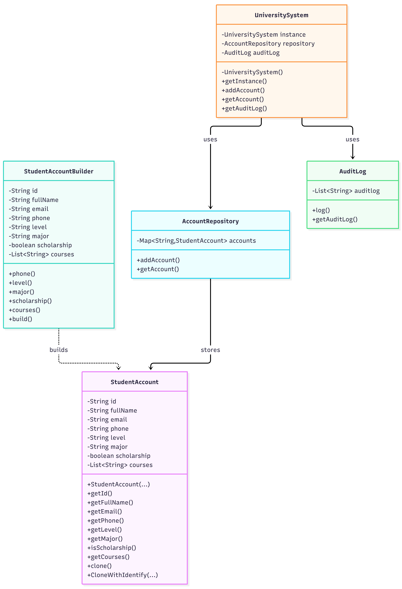
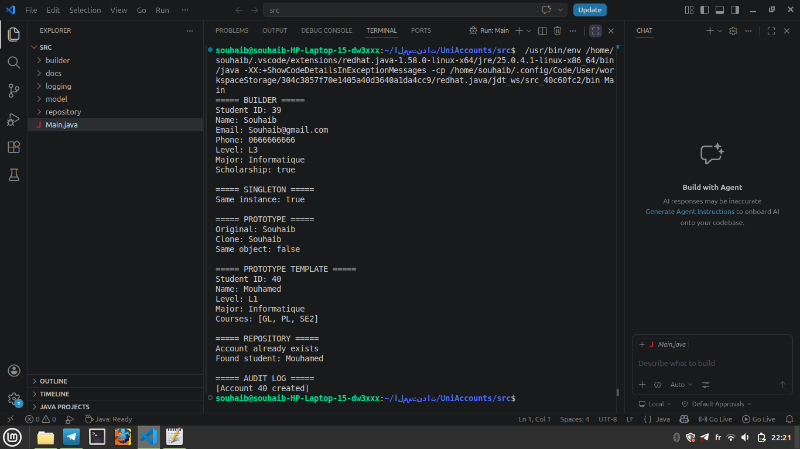

Projet UniAccounts
1. Introduction
Le projet UniAccounts consiste à développer le noyau d’un système de gestion des comptes étudiants.
Lorsqu’un nouvel étudiant rejoint l’université, un compte est créé pour contenir ses informations personnelles et académiques. Le système permet de créer les comptes, de les stocker dans un dépôt central et d'enregistrer les opérations effectuées dans un journal d'audit.
L'objectif de ce travail pratique est d'appliquer trois patrons de conception créationnels : Builder, Singleton et Prototype.
2. Objectif du projet
L'objectif est de construire un système organisé et réutilisable qui permet :
De créer des comptes étudiants avec des informations obligatoires et facultatives.
De garantir l'existence d'une seule instance du système.
De créer de nouveaux comptes à partir d'un compte modèle.
De centraliser le stockage des comptes.
D'enregistrer les opérations dans un journal d'audit.

3. Le patron Builder

Le patron Builder est un patron de conception créationnel qui permet de construire un objet étape par étape.

Dans notre projet, la classe "StudentAccountBuilder" permet de créer un compte étudiant en séparant les informations obligatoires des informations facultatives.

Informations obligatoires :

- id
- fullName
- email

Informations facultatives :

- phone
- level
- major
- scholarship
- courses

La méthode "build()" permet de construire et de retourner l'objet "StudentAccount".

Pourquoi utiliser Builder ?

Ce patron évite d'utiliser un constructeur avec un grand nombre de paramètres, réduit les erreurs et facilite la création des comptes étudiants.
4. Le patron Singleton

Le patron Singleton est un patron de conception qui garantit qu'une classe possède une seule instance et fournit un point d'accès global à cette instance.

Dans notre projet, la classe "UniversitySystem" applique ce patron.

Elle contient :

- Un attribut statique "instance" qui conserve l'unique instance.
- Un constructeur privé "private UniversitySystem()" qui empêche la création d'objets depuis l'extérieur.
- Une méthode "getInstance()" qui crée l'instance si elle n'existe pas et retourne toujours la même instance.

Pourquoi utiliser Singleton ?

Ce patron garantit que tous les utilisateurs du système accèdent à la même instance centrale, qui gère le dépôt des comptes étudiants et le journal d'audit.
5. Le patron Prototype

Le patron Prototype est un patron de conception créationnel qui permet de créer de nouveaux objets en copiant un objet existant.

Dans notre projet, la classe "StudentAccount" applique ce patron grâce à la méthode "clone()".

Cette méthode permet de créer une copie d'un compte étudiant sans reconstruire l'objet depuis zéro.

Nous avons également utilisé la méthode "CloneWithIdentify()" pour créer un nouveau compte à partir d'un compte modèle, tout en modifiant les informations d'identification : "id", "fullName" et "email".

Pourquoi utiliser Prototype ?

Ce patron facilite la création de nouveaux comptes à partir d'un modèle existant, évite de répéter les mêmes informations et permet de gagner du temps.
6. Organisation du projet

Le projet UniAccounts est organisé en plusieurs packages afin de séparer les responsabilités et de faciliter la maintenance du code.

La structure du projet est la suivante :

- "model" : contient les classes "StudentAccount" et "UniversitySystem".
- "builder" : contient la classe "StudentAccountBuilder".
- "repository" : contient la classe "AccountRepository".
- "logging" : contient la classe "AuditLog".
- "Main.java" : contient le programme principal qui permet de tester les fonctionnalités.

Cette organisation rend le projet plus clair, structuré et facile à comprendre.

### Diagramme UML

7. Tests et résultats

Plusieurs tests ont été réalisés dans la classe "Main.java" afin de vérifier le bon fonctionnement des patrons de conception.

Les résultats obtenus sont les suivants :

- Builder : création d'un compte étudiant avec les informations obligatoires et facultatives.
- Singleton : vérification que deux appels à "getInstance()" retournent la même instance.
- Prototype : création d'une copie d'un compte étudiant et vérification que la copie est un objet différent de l'original.
- Repository : ajout et recherche d'un compte étudiant, avec refus des identifiants dupliqués.
- AuditLog : enregistrement des opérations effectuées sur le système.

Les tests ont été exécutés avec succès. Les résultats affichés dans le terminal confirment le bon fonctionnement des fonctionnalités principales.
### Capture d'exécution

La figure suivante présente les résultats obtenus après l'exécution du programme dans le terminal.

8. Conclusion

Ce travail pratique nous a permis de mettre en application trois patrons de conception créationnels : Builder, Singleton et Prototype.

Nous avons développé un système simple de gestion des comptes étudiants permettant de créer, copier et stocker les comptes, tout en enregistrant les opérations effectuées.

L'utilisation de ces patrons a permis d'obtenir une application mieux organisée, réutilisable et facile à maintenir.

